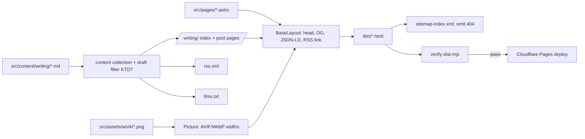

# Astro Blog and Cloudflare Migration - Plan

## Goal Capsule

**Objective:** Rebuild thomasofficer.com on Astro with a Markdown blog at `/writing/`, host it on Cloudflare Pages, and keep every existing page visually identical at its current URL.

**Authority:** Product Contract requirements (R-IDs) win on behavior. Key Technical Decisions (KTD-IDs) win on mechanism. Units carry local detail only.

**Stop and ask when:**
- A page cannot match its current rendering without changing `style.css` rules beyond font URL paths.
- The DNS cutover (U8) is reached. It changes production DNS, so the user performs or approves each dashboard step. Also obtain approval for U9’s publishing-source change.
- Astro 7 or an integration rejects a requirement (for example, `@astrojs/sitemap` is incompatible with the installed Astro major).

**Execution profile:** U1 has been verified in the GitHub dashboard: Enforce HTTPS is enabled. U2–U7 are code on one feature branch, landed as one PR only after U9 preserves the existing GitHub Pages deployment. U8 is the separately approved production cutover. Planning does not authorize dashboard changes or DNS changes.

---

## Product Contract

### Summary

Move the five hand-written HTML pages into Astro layouts that generate the head, metadata, sitemap, feed and `llms.txt` from one source. Add a `/writing/` blog fed by Markdown files. Serve the build from Cloudflare Pages with cache headers, PR previews, Web Analytics and enforced HTTPS.

### Problem Frame

Each page duplicates about 50 lines of head, Open Graph and JSON-LD markup. The sitemap, `llms.txt` and responsive images are maintained by hand. There is no way to publish a post without hand-writing another full HTML page. The migration adds configurable cache headers and PR previews. HTTPS enforcement on the existing GitHub Pages site was enabled on October 28, 2026.

### Requirements

**Parity**
- R1. The home page, resume and three case studies render with the same visible design at mobile, tablet and desktop widths.
- R2. The existing clean URLs (`/`, `/resume`, `/work/echo`, `/work/afterpattern`, `/work/blueridgelabs`) return 200. The legacy `.html` URLs redirect to them with a 301.
- R3. The case-study lightbox and the resume "download as Markdown" button keep working.
- R4. All page text is present in the HTML response, with no client-side rendering.

**Blog**
- R5. Published posts are Markdown files with validated title, description, publish date, optional updated date, optional OG image, and a draft flag that defaults to true.
- R6. Posts are served at `/writing/<slug>`. `/writing` appears at launch with the heading “Writing” and the empty state “No articles yet”; published posts later appear newest first.
- R7. Private drafts stay on Thomas’s computer outside the public website repository. All built deployments, including PR previews, exclude drafts from pages, RSS, sitemap and `llms.txt`. Local development may display an explicitly supplied local draft.
- R8. Each post page carries a BlogPosting JSON-LD block, `og:type=article`, `article:published_time`, and a `summary_large_image` card. The OG image is the post's own image or a default 1200×630 image.
- R9. Article pages have no social sharing controls or copy-link button in this version. (session-settled: user-directed — chosen over sharing controls: keep launch simple.)

**Discovery**
- R10. Every page has a unique title, description, canonical URL and OG tags, generated from one layout.
- R11. The build generates the sitemap, an RSS feed at `/rss.xml`, and `llms.txt` (which lists published posts). Every page links the feed for autodiscovery.
- R12. `robots.txt` continues to allow all crawlers, AI crawlers included, and points to the generated sitemap.

**Performance and hosting**
- R13. Case-study and post images are served as AVIF/WebP at responsive widths, generated at build time from PNG sources.
- R14. Production client JS is limited to the existing lightbox, resume download and basic analytics beacon; no framework hydration or sharing scripts are added.
- R15. The site deploys from `master` to Cloudflare Pages, with a preview URL for each PR.
- R16. Hashed build assets are cached for one year, immutable.
- R17. Enable basic Cloudflare Web Analytics without adding custom tracking, cookies or a consent banner.
- R18. HTTPS is enforced, and the apex domain redirects to `https://www.thomasofficer.com`.

### Scope Boundaries

**Not in scope:**
- Redesign or copy changes to existing pages.
- Comments, newsletter signup, tags or categories, site search, MDX.
- Writing real posts. Launch contains zero posts; test fixtures are synthetic and never deployed.
- A CMS, publishing dashboard, remote drafts, or a private draft repository. Thomas asks Codex to publish a finished article; only then is its Markdown copied into the website repository.

**Deferred to Follow-Up Work:**
- OG images generated at build time (for example with Satori). Default plus per-post static images cover launch.
- Subsetting the Concourse and Heliotrope fonts and auditing which weights are actually used.
- An `llms-full.txt` containing full post bodies.

---

## Planning Contract

### Key Technical Decisions

- KTD1. Use Astro 7 as a fully static build with no adapter. (session-settled: user-approved — chosen over Eleventy: built-in image pipeline and typed content collections.) Pin compatible stable Astro, sitemap, RSS and check-tool versions with a lockfile during U2. Set an exact supported Node release in `.nvmrc` and the Cloudflare build environment; confirm the installed Astro package’s engine requirement instead of assuming any Node 22 release works.
- KTD2. Retain Cloudflare Pages with Git integration for this version. (session-settled: user-approved — chosen over GitHub Pages: cache headers, PR previews and basic Web Analytics.) Current Astro guidance recommends Workers for new projects; Pages remains the chosen static host. Any later Workers move requires separate validation of routing, redirects, analytics and deployment configuration; it is outside this migration.
- KTD3. Set `build.format: 'file'` and `trailingSlash: 'never'`. Output is `dist/work/echo.html`, which Cloudflare Pages serves at `/work/echo` with a 200 and no redirect. This matches the current canonical URLs and sitemap entries. Cloudflare Pages already redirects `/x.html` to `/x`.
- KTD4. Set `compressHTML: true`. Astro 7's default `'jsx'` mode can collapse whitespace between inline elements, which would alter text such as the hero headline spans. The Astro 7 compiler also rejects invalid nesting, so markup is fixed during porting rather than worked around.
- KTD5. Import `style.css` from `src/styles/` through the base layout so it is hashed and cached as immutable. Fonts move to `public/assets/fonts/` unchanged, and the `@font-face` URLs become root-absolute (`/assets/fonts/...`). This is the only permitted `style.css` edit.
- KTD6. Move the PNG originals to `src/assets/work/` and render them with `<Picture formats={['avif','webp']}>`, keeping the current widths (480/768/960/1600) and `sizes` strings. Delete `assets/work/responsive/`. (session-settled: user-directed — chosen over keeping both: removes 5.4 MB of duplicate images.) The lightbox's full-size `data-full-src` points to a build-generated WebP at the original width.
- KTD7. Per R7, load only published website content for every static build, regardless of branch variables. Require `draft: false` explicitly before an entry can enter any build output; missing flags are private by default. Keep private source drafts in the existing local writing home. If Thomas requests local website preview, use a gitignored `.local-drafts/` directory loaded only in local development, visibly labelled Draft and noindex. Never copy this directory into public content as part of the migration. The sitemap derives URLs from generated pages and does not call content collection APIs from config.
- KTD8. Published posts live in `src/content/writing/` and are served at `/writing/<slug>`; the content collection ID supplies the slug. (session-settled: user-directed — chosen over `/blog` and `/posts`.) A “Writing” link joins the footer on every page immediately, including when no articles exist (R6). No additional homepage promotion is added.
- KTD9. Generate `llms.txt` and `rss.xml` from endpoint files (`src/pages/llms.txt.ts`, `src/pages/rss.xml.ts`), with no community integrations. `rss()` gets `trailingSlash: false` to match KTD3.
- KTD10. Keep JS small per R14. Process the lightbox script in the case-study layout. Preserve the resume download’s inline script and template literal. R9 requires no sharing component or script.
- KTD11. Add a build gate: `npm run build` runs `astro build` and then `scripts/verify-dist.mjs`. Cloudflare's build command is `npm run build`, so a failed check blocks the deploy.
- KTD12. Move authoritative DNS to Cloudflare while keeping domain registration at GoDaddy. (session-settled: user-directed — chosen over keeping current DNS.) Preserve all existing unrelated DNS records; Thomas confirms no domain email is in use. Use a Cloudflare Redirect Rule for apex-to-www, preserving paths and query strings. `_redirects` does not own cross-domain redirects.

### High-Level Technical Design

Build pipeline:



Cutover sequence (U8):

```mermaid
sequenceDiagram
  participant U as User (dashboards)
  participant CF as Cloudflare
  participant GH as GitHub Pages
  U->>GH: Verify HTTPS and preserve legacy publishing branch (U1, U9)
  U->>CF: Create Pages project, build master, check *.pages.dev
  U->>CF: Import and audit DNS records; keep GitHub records DNS-only
  U->>U: Disable DNSSEC at registrar, switch nameservers
  CF->>CF: Issue cert, attach www custom domain
  U->>CF: Apex placeholder + Redirect Rule to www, enable Web Analytics
  U->>GH: After DNS propagation and verification, disable Pages
```

### Output Structure

```
README.md
astro.config.mjs
package.json
package-lock.json
.nvmrc
public/
  _headers
  _redirects
  robots.txt
  assets/fonts/...            (moved unchanged)
  assets/tfo-favicon.ico, tfo-brand-black.svg, tfo-headshot-2024.png
  assets/work/logo-*.png
  og/default.png              (new, 1200x630)
scripts/verify-dist.mjs
src/
  content.config.ts
  content/writing/            (empty at launch; published Markdown only)
  assets/work/*.png           (moved originals)
  components/Seo.astro, Footer.astro, HomeLogo.astro
  layouts/BaseLayout.astro, CaseStudyLayout.astro, PostLayout.astro
  lib/posts.ts                (draft filter, KTD7)
  pages/index.astro, resume.astro, 404.astro
  pages/work/echo.astro, afterpattern.astro, blueridgelabs.astro
  pages/writing/index.astro, [...id].astro
  pages/rss.xml.ts, llms.txt.ts
  scripts/lightbox.js
  styles/style.css, writing.css
```

### Assumptions

- Thomas has an existing Cloudflare account; sign-in needs confirmation during U8. The registrar is GoDaddy; registrar access and the current authoritative DNS provider must be checked before cutover. No account or domain transfer is planned.
- No other service depends on the GitHub Pages deploy of this repo.

---

## Implementation Units

### U1. Enforce HTTPS on GitHub Pages now

**Goal:** Close the current HTTPS gap before any migration work.
**Requirements:** R18 (interim).
**Dependencies:** None.
**Files:** None (repository Settings → Pages).
**Approach:** Keep the enabled Enforce HTTPS setting. It was verified after refreshing the GitHub Pages settings on October 28, 2026. Check the HTTP redirect during deployment verification; do not assume a dashboard check alone verifies the response.
**Test expectation:** none -- dashboard setting.
**Verification:** `http://www.thomasofficer.com/` returns a 301 to `https://`.

### U9. Preserve the live site before merging Astro

**Goal:** Keep the existing GitHub Pages site live while `master` changes to Astro source.
**Requirements:** R1–R3, R15; production continuity.
**Dependencies:** U1; must complete before merging U2–U7.
**Files:** none; preserve the current static repository tree on `codex/legacy-site`.
**Approach:** Create the branch from the latest verified static `master` commit, including the October 28 typography fix. With Thomas’s approval, switch GitHub Pages publishing to that branch at `/` while retaining the custom domain and HTTPS. Wait for its deployment, then verify all five live routes and existing interactions before merging Astro. Keep a recorded commit ID and branch for rollback.
**Test expectation:** none -- dashboard and deployment configuration.
**Verification:** GitHub Pages shows the preserved branch as source; all five existing pages still render; the Astro PR is not merged until this is confirmed.


### U2. Scaffold Astro and relocate static assets

**Goal:** An Astro project builds next to the existing files, with assets in their final locations.
**Requirements:** R14, R16 (groundwork).
**Dependencies:** None.
**Files:** `package.json`, `package-lock.json`, `astro.config.mjs`, `tsconfig.json`, `.nvmrc`, `.gitignore`, `public/assets/**`, `public/robots.txt`, `src/styles/style.css`, `scripts/verify-dist.mjs` (initial skeleton).
**Approach:**
1. Resolve compatible stable Astro 7, sitemap, RSS, Astro check and TypeScript versions; record exact versions and a lockfile. Confirm the chosen Node version meets the installed engine requirement. A dependency conflict blocks implementation until resolved without silently changing scope.
2. Configure `site: 'https://www.thomasofficer.com'` and the settings from KTD3 and KTD4.
3. Move fonts, favicon, brand SVG, headshot, logos and `robots.txt` into `public/` (KTD5).
4. Move `style.css` into `src/styles/` and rewrite only its font URLs.
5. Ignore `dist/`, `node_modules/`, `.astro/` and `.local-drafts/`. Do not import private drafts during scaffolding.
6. Wire `npm run build` to the verify script (KTD11).
**Execution note:** This is scaffolding. Prove it with a smoke build, not unit tests.
**Test expectation:** none -- scaffolding. U7 adds the assertions.
**Verification:** `npm run build` succeeds and produces `dist/`.

### U3. Base layout and SEO component

**Goal:** One layout owns head, metadata, structured data, nav logo and footer.
**Requirements:** R10, R11 (autodiscovery link), R8 (card type), KTD8.
**Dependencies:** U2.
**Files:** `src/layouts/BaseLayout.astro`, `src/components/Seo.astro`, `src/components/HomeLogo.astro`, `src/components/Footer.astro`, `public/og/default.png`.
**Approach:**
- Props: title, description, canonical path, OG type, OG image, JSON-LD object(s), font preload list, body class, `noindex`.
- Every article uses `summary_large_image` per R8; home and resume retain `summary`, and case studies retain their current card types. Article head metadata includes `article:published_time` and optional modified time.
- The Person and WebSite JSON-LD nodes live in one shared module so pages reference `#person` by `@id`.
- The footer gains the "Writing" link (KTD8).
- Produce a simple 1200×630 default article card using the existing brand mark and Thomas Officer’s name. Review it alongside the new writing layout before launch. Social metadata remains useful when readers share links even though R9 removes sharing buttons.
**Patterns to follow:** The head in `index.html` and `work/echo.html` is the reference for tag order and content.
**Test scenarios:** covered by `scripts/verify-dist.mjs` in U7 (each built page has exactly one title, description, canonical and `og:*` set, and its JSON-LD parses).
**Verification:** The head of the built `dist/index.html` contains the same tags and values as the current `index.html`, apart from asset paths.

### U4. Port the five existing pages

**Goal:** Home, resume and case studies render identically from Astro.
**Requirements:** R1, R2, R3, R4, R13, KTD6, KTD10.
**Dependencies:** U3.
**Files:** `src/pages/404.astro`, `src/pages/index.astro`, `src/pages/resume.astro`, `src/pages/work/echo.astro`, `src/pages/work/afterpattern.astro`, `src/pages/work/blueridgelabs.astro`, `src/layouts/CaseStudyLayout.astro`, `src/scripts/lightbox.js`, `src/assets/work/*.png`; delete `index.html`, `resume.html`, `work/*.html`, `lightbox.js`, `assets/work/responsive/`, `sitemap.xml`. Keep `CNAME` until U8.
**Approach:**
1. Copy body markup verbatim. Change internal links from `*.html` to clean paths.
2. Replace each `<picture>` block with `<Picture>`, keeping alt text, `class="portfolio-image"`, `fetchpriority`/`loading`, `sizes`, captions and `data-full-src` (KTD6).
3. Keep each page's font preload list and CreativeWork or ProfilePage JSON-LD as layout props.
4. Fix any invalid nesting the Astro 7 compiler rejects (KTD4).
5. Generate absolute, build-resolved PNG URLs for case-study OG, Twitter and JSON-LD images from the imported sources; verify they resolve after PNG originals move.
6. Add a noindex 404 page using BaseLayout, with links home and to Writing. Verify unknown routes return HTTP 404 rather than the homepage with 200.
**Execution note:** Capture screenshots of the current live pages at 375, 768 and 1280 px before porting. They are the parity baseline. Also record Lighthouse Performance and SEO results for the home page and one case study under consistent device/network settings; investigate repeatable regressions rather than treating score noise as a failure.
**Test scenarios:**
- Each of the five URLs builds to the expected `dist/` file (U7 asserts this).
- Visual comparison: each page at 375/768/1280 px matches the baseline screenshot, with the footer "Writing" link as the only difference.
- Clicking a case-study image opens the lightbox with the full-size image and caption. Esc and the overlay close it.
- The resume download button saves a Markdown file whose content is identical to today's.
- With JS disabled, all page text is still visible.
**Verification:** The scenarios above pass in `npm run preview` and in `npx wrangler pages dev dist`.

### U5. Writing collection, index and post layout

**Goal:** A simple writing section ready for finished Markdown articles, empty at launch.
**Requirements:** R5–R9, KTD7, KTD8, KTD10.
**Dependencies:** U3.
**Files:** `src/content.config.ts`, `src/lib/posts.ts`, `src/pages/writing/index.astro`, `src/pages/writing/[...id].astro`, `src/layouts/PostLayout.astro`, `src/styles/writing.css`, `tests/fixtures/writing/` (synthetic content only).
**Approach:**
1. Define the R5 schema, including a draft flag defaulting to true; validate dates and images. Use the KTD7 publication selection for the index, route generation, RSS and `llms.txt`.
2. Render the index with its heading and R6 empty state. Once published content exists, entries show a linked title, date and description, newest first.
3. Article order: link back to Writing, title, publish date, optional updated date, body and the shared footer. Use readable dates such as “October 28, 2026”. No sharing controls (R9).
4. Keep new styles in `writing.css`, scoped to writing pages so existing CSS rules remain unchanged except font paths. Cover headings, paragraphs, lists, links, blockquotes, code, images and tables using synthetic fixtures.
5. Emit BlogPosting JSON-LD, author identity, absolute OG image, `article:published_time` and R8 card metadata.
6. Implement local draft loading only in development as KTD7 specifies. Document it without copying any private material into the repo.
**Test scenarios:**
- Empty content produces “No articles yet” at `/writing` and the footer link remains present.
- A synthetic published article renders its title, date and body without JS, with a link back to Writing.
- Draft, missing-draft-flag and local-only fixtures are absent from builds with master, preview and unset branch variables, including generated discovery files and built assets.
- Local development can display a synthetic `.local-drafts/` article with a visible Draft label and noindex; a subsequent build excludes it.
- Missing descriptions or invalid dates fail schema validation.
- Optional OG images and the default resolve to real built files; article metadata and JSON-LD agree.
- Test fixtures are never deployed or listed in production output.
**Verification:** U7 enforces build exclusion; browser checks cover typography at mobile and desktop widths using temporary synthetic content.

### U6. Feeds, sitemap, llms.txt, headers and redirects

**Goal:** Generated discovery files and hosting rules.
**Requirements:** R2, R11, R12, R16, KTD9.
**Dependencies:** U4, U5.
**Files:** root `llms.txt` (remove after migrating its text), `src/pages/rss.xml.ts`, `src/pages/llms.txt.ts`, `astro.config.mjs` (sitemap), `public/robots.txt`, `public/_headers`, `public/_redirects`.
**Approach:**
- RSS: title, description and pubDate for each published post.
- `llms.txt`: the current hand-written content plus a generated "Writing" section.
- Sitemap: generate URLs from built pages and omit the 404 route. Leave `lastmod` out for launch instead of adding a second frontmatter parser in configuration. No config-time import of `astro:content`.
- `robots.txt`: point the `Sitemap:` line at `sitemap-index.xml`.
- `_redirects`: `/sitemap.xml` → `/sitemap-index.xml`, plus explicit 301s for the five legacy `.html` paths, as a safeguard over Pages' automatic handling.
- `_headers`:
  - `/_astro/*`: `public, max-age=31536000, immutable`.
  - `/assets/fonts/*`: a 30-day max-age, because the files are not hashed.
  - Nothing sets `no-transform`, which would block analytics injection.
**Test scenarios:**
- `rss.xml` is valid RSS 2.0, lists only published posts, and its links have no trailing slash.
- `sitemap-0.xml` contains the five existing URLs and the `/writing` index, with no `.html` suffixes and no drafts.
- `llms.txt` contains the existing sections and a Writing section.
- Under `wrangler pages dev dist`, `/resume.html` and `/work/echo.html` return a 301 to the clean URL, and `/sitemap.xml` redirects.
**Verification:** U7's assertions plus the `wrangler pages dev` redirect checks pass.

### U7. Build-time verification script

**Goal:** A failing check blocks a bad deploy.
**Requirements:** R2, R4, R7, R8, R10, R11 (enforcement).
**Dependencies:** U4, U5, U6.
**Files:** `scripts/verify-dist.mjs`, `package.json`, `README.md`, `tests/fixtures/writing/`.
**Approach:** A dependency-free Node script reads `dist/` and exits non-zero with a list of every failure. It asserts:
- expected HTML files exist, including `404.html`;
- each page has one `<title>`, one meta description, a canonical URL starting with the `site` host, `og:title`/`og:description`/`og:image`, and JSON-LD that parses;
- article pages have a BlogPosting node, article publication time and `summary_large_image`; local OG image URLs resolve to files in the build;
- every build excludes synthetic draft sentinels and draft assets, regardless of branch variables; the route set comes from published input and excludes the 404 page from the sitemap;
- no `.html` suffix appears in canonical URLs or the sitemap;
- robots allows crawlers and points to the generated sitemap; responsive case-study images include AVIF/WebP; immutable cache configuration covers hashed assets;
- the production browser has only the R14 permitted scripts, including Cloudflare’s injected analytics beacon.

Write `README.md` explaining local development, private drafts outside Git, publishing by explicit request to Codex, required metadata, deployment and rollback.
**Test scenarios:**
- Clean empty-content builds with master, preview and unset branch variables pass. A temporary published synthetic fixture also passes, then is removed before the deployable build.
- Delete a page's description: it exits 1 and names the file.
- Temporarily bypass draft selection using a synthetic sentinel: verification fails and names the leak. Confirm private draft directories are ignored and no fixture or private draft is staged before committing.
**Verification:** All three scenarios behave as listed.

### U8. Cloudflare cutover

**Goal:** Production serves from Cloudflare, with analytics, HTTPS and the apex redirect.
**Requirements:** R15, R17, R18, KTD2, KTD12.
**Dependencies:** U2–U7 merged to `master` after U9’s preservation check. Cloudflare and GoDaddy sign-in available; current DNS records and DNSSEC state inspected.
**Files:** delete `CNAME` after cutover.
**Approach:** Perform dashboard changes only with Thomas’s approval at that step.
1. Create a Git-connected Pages project building `master`, with the locked Node version, build command `npm run build`, and output `dist`. Enable PR previews. Check the `pages.dev` site before changing domain records.
2. Export or record the existing DNS zone and relevant GitHub Pages settings for rollback. Add the zone to Cloudflare; compare all imported records with the current provider. Thomas has no domain email, but retain unrelated records. Keep imported GitHub www/apex records DNS-only and use Full (strict) SSL, avoiding Flexible redirect loops.
3. Inspect DNSSEC at the registrar. If enabled, remove the old DS configuration before changing nameservers and follow provider guidance for propagation. Change nameservers at GoDaddy only after the zone audit. Keep the preserved GitHub site serving through this transition.
4. Add www as a custom domain through the Pages dashboard before repointing its CNAME. Replace conflicting GitHub website records, rather than creating duplicates. Replace apex records with the proxied redirect configuration and preserve path/query in the apex-to-www rule. Enable Always Use HTTPS; verify certificate activation.
5. Enable basic Web Analytics and run the live checks below. Keep GitHub Pages and its domain association until the prior DNS TTL has elapsed and both the new deployment and an independent resolver check succeed.
6. After Thomas approves cleanup, remove GitHub’s custom domain and disable GitHub Pages. Remove root `CNAME` from the Astro branch. Retain the legacy branch and recorded DNS/settings as a recovery source; do not delete it automatically. Restore DNSSEC with Cloudflare’s new DS data after nameservers are stable, if previously enabled.
**Rollback:** Before disabling GitHub Pages, restore the saved website records pointing at GitHub; keep Cloudflare nameservers and unrelated records in place to avoid a second nameserver migration. After cleanup, first re-enable GitHub Pages on the preserved branch and restore its domain association, then restore website records. Verify certificate readiness and HTTP responses before declaring recovery. Cloudflare deployment rollback handles code-only regressions after launch; switching origins may require certificate reactivation.
**Test scenarios:**
- `https://thomasofficer.com/resume` returns a 301 to `https://www.thomasofficer.com/resume`.
- `http://www.thomasofficer.com/` redirects to HTTPS.
- Saved unrelated DNS records remain intact; no email is sent or configured.
- Unknown paths return 404, article/index routes behave correctly, and the apex redirect preserves path and query.
- A test PR gets a preview URL containing public content only; drafts are absent.
- The Web Analytics dashboard records a visit within an hour, and the site sets no cookies.
**Verification:** All scenarios pass, and GitHub Pages no longer serves the domain.

---


---

## Verification Contract

- `npm run build` runs `astro build` plus `scripts/verify-dist.mjs` and must exit 0. This is the deploy gate.
- `npx astro check` reports no errors.
- Build with master, preview and unset branch variables: all pass with only public content (KTD7). Test default-private and local draft exclusion with synthetic fixtures. Never test using Thomas’s private writing.
- `npx wrangler pages dev dist` is used for routing and redirect checks (KTD3, U6).
- Visual parity: screenshots at 375/768/1280 px for each existing page are compared with the pre-migration baseline (U4).
- After cutover, repeat U4’s Lighthouse checks under the same conditions and investigate repeatable Performance or SEO regressions. Verify response headers on the deployed host, where the CDN applies them.

## Definition of Done

- R1–R18 are each satisfied and traceable to a passing scenario.
- The production site serves from Cloudflare at `https://www.thomasofficer.com`, and GitHub Pages is disabled.
- No leftover hand-maintained files remain: root `*.html`, `lightbox.js`, `sitemap.xml`, root `llms.txt`, `assets/work/responsive/` and `CNAME` are gone from the Astro branch; the preserved legacy branch remains available.
- No abandoned experimental code, unused dependencies or commented-out blocks remain in the diff.
- The README (new, short) states how to add a post, how drafts work and how deploys happen.

---

## Risks & Dependencies

- **Astro 7 compiler strictness.** Hand-written markup may contain nesting it rejects. Mitigation: fix it during porting under the U4 visual check.
- **Whitespace drift.** Mitigation: KTD4 plus the visual comparison.
- **DNS move disrupts existing services.** Mitigation: U8 preserves and audits all existing records. No email service is used; do not send test emails.
- **AVIF build time on large PNG screenshots.** Mitigation: Astro caches images in `node_modules/.astro`. If builds exceed a few minutes, downscale the source PNGs to 2400 px wide.
- **Pages vs Workers direction (KTD2).** Keep the selected Pages scope for launch; evaluate any future Workers move separately.

## Sources & Research

- Astro installation and runtime requirements: https://docs.astro.build/en/install-and-setup/
- Cloudflare custom domain association: https://developers.cloudflare.com/pages/configuration/custom-domains/
- Astro 7 upgrade guide: https://docs.astro.build/en/guides/upgrade-to/v7/
- Content collections: https://docs.astro.build/en/guides/content-collections/
- Images: https://docs.astro.build/en/guides/images/
- RSS recipe: https://docs.astro.build/en/recipes/rss/
- Sitemap integration: https://docs.astro.build/en/guides/integrations-guide/sitemap/
- Astro on Cloudflare: https://docs.astro.build/en/guides/deploy/cloudflare/
- Pages serving and `.html` handling: https://developers.cloudflare.com/pages/configuration/serving-pages/
- Pages to Workers migration: https://developers.cloudflare.com/workers/static-assets/migration-guides/migrate-from-pages/
- Web Analytics setup: https://developers.cloudflare.com/web-analytics/get-started/
- Repo references: `work/echo.html` (picture markup, CreativeWork JSON-LD, lightbox hooks), `resume.html` (inline download script), `lightbox.js` (`.portfolio-image` and `data-full-src` contract), `style.css` (`@font-face` URLs, `@media print`).
