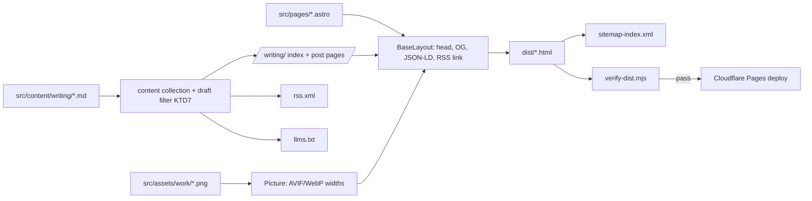
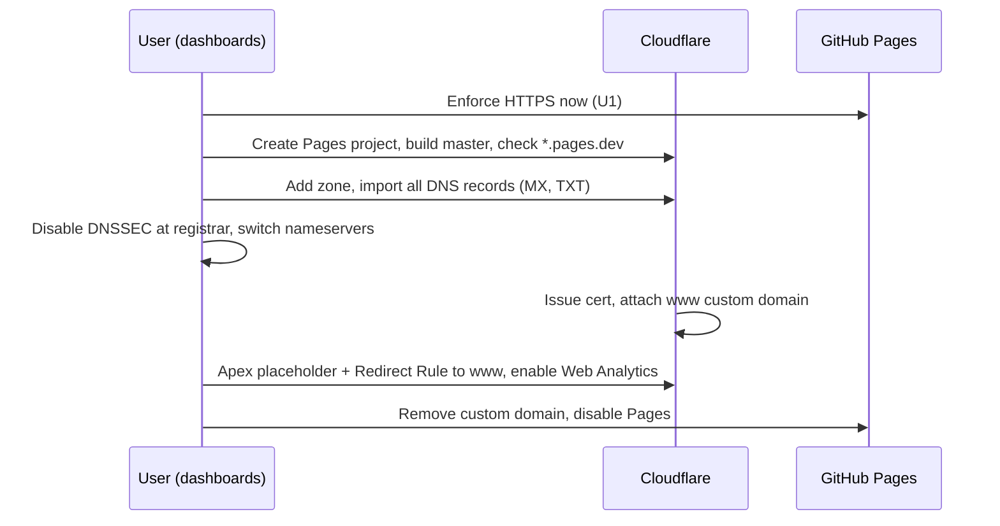

# Astro Blog and Cloudflare Migration - Plan

## Goal Capsule

**Objective:** Rebuild thomasofficer.com on Astro with a Markdown blog at `/writing/`, host it on Cloudflare Pages, and keep every existing page visually identical at its current URL.

**Authority:** Product Contract requirements (R-IDs) win on behavior. Key Technical Decisions (KTD-IDs) win on mechanism. Units carry local detail only.

**Stop and ask when:**
- A page cannot match its current rendering without changing `style.css` rules beyond font URL paths.
- The DNS cutover (U8) is reached. It changes nameservers and email routing, so the user performs or approves each dashboard step.
- Astro 7 or an integration rejects a requirement (for example, `@astrojs/sitemap` is incompatible with the installed Astro major).

**Execution profile:** U1 and U8 are dashboard operations the user performs. U2–U7 are code on one feature branch, landed as one PR. The production site stays on GitHub Pages until U8.

---

## Product Contract

### Summary

Move the five hand-written HTML pages into Astro layouts that generate the head, metadata, sitemap, feed and `llms.txt` from one source. Add a `/writing/` blog fed by Markdown files. Serve the build from Cloudflare Pages with cache headers, PR previews, Web Analytics and enforced HTTPS.

### Problem Frame

Each page duplicates about 50 lines of head, Open Graph and JSON-LD markup. The sitemap, `llms.txt` and responsive images are maintained by hand. There is no way to publish a post without hand-writing another full HTML page. GitHub Pages does not allow cache headers or PR previews, and HTTPS is not enforced today.

### Requirements

**Parity**
- R1. The home page, resume and three case studies render with the same visible design at mobile, tablet and desktop widths.
- R2. The existing clean URLs (`/`, `/resume`, `/work/echo`, `/work/afterpattern`, `/work/blueridgelabs`) return 200. The legacy `.html` URLs redirect to them with a 301.
- R3. The case-study lightbox and the resume "download as Markdown" button keep working.
- R4. All page text is present in the HTML response, with no client-side rendering.

**Blog**
- R5. Posts are Markdown files with typed frontmatter: title, description, publish date, optional updated date, optional OG image, and a draft flag.
- R6. Posts are served at `/writing/<slug>`, and `/writing` lists published posts newest first.
- R7. Draft posts appear in local dev and PR previews and never in production pages, RSS, sitemap or `llms.txt`.
- R8. Each post page carries a BlogPosting JSON-LD block, `og:type=article`, `article:published_time`, and a `summary_large_image` card. The OG image is the post's own image or a default 1200×630 image.
- R9. Each post has share links for X, LinkedIn and Bluesky, plus a copy-link button.

**Discovery**
- R10. Every page has a unique title, description, canonical URL and OG tags, generated from one layout.
- R11. The build generates the sitemap, an RSS feed at `/rss.xml`, and `llms.txt` (which lists published posts). Every page links the feed for autodiscovery.
- R12. `robots.txt` continues to allow all crawlers, AI crawlers included, and points to the generated sitemap.

**Performance and hosting**
- R13. Case-study and post images are served as AVIF/WebP at responsive widths, generated at build time from PNG sources.
- R14. Client JS is limited to the lightbox, the resume download, the copy-link button and the analytics beacon.
- R15. The site deploys from `master` to Cloudflare Pages, with a preview URL for each PR.
- R16. Hashed build assets are cached for one year, immutable.
- R17. Cloudflare Web Analytics counts visits without cookies or a consent banner.
- R18. HTTPS is enforced, and the apex domain redirects to `https://www.thomasofficer.com`.

### Scope Boundaries

**Not in scope:**
- Redesign or copy changes to existing pages.
- Comments, newsletter signup, tags or categories, site search, MDX.
- Writing real posts. Only one draft placeholder ships.

**Deferred to Follow-Up Work:**
- OG images generated at build time (for example with Satori). Default plus per-post static images cover launch.
- Subsetting the Concourse and Heliotrope fonts and auditing which weights are actually used.
- An `llms-full.txt` containing full post bodies.

---

## Planning Contract

### Key Technical Decisions

- KTD1. Use Astro 7 as a fully static build with no adapter. (session-settled: user-approved — chosen over Eleventy: built-in image pipeline and typed content collections.) Pin the exact version at install time and set Node 22 in `.nvmrc`. Astro 7 requires `src/content.config.ts`, `glob()` loaders, and `z` imported from `astro/zod`.
- KTD2. Host on Cloudflare Pages with Git integration. (session-settled: user-approved — chosen over staying on GitHub Pages: cache headers, PR previews, one-click Web Analytics.) **Conflict note:** Astro's deploy guide now recommends Cloudflare Workers static assets for new projects. Pages is still supported, and the one-click Web Analytics is documented only for Pages. The build output, `_headers` and `_redirects` are identical on both, so switching later means changing deploy config only, not site code.
- KTD3. Set `build.format: 'file'` and `trailingSlash: 'never'`. Output is `dist/work/echo.html`, which Cloudflare Pages serves at `/work/echo` with a 200 and no redirect. This matches the current canonical URLs and sitemap entries. Cloudflare Pages already redirects `/x.html` to `/x`.
- KTD4. Set `compressHTML: true`. Astro 7's default `'jsx'` mode can collapse whitespace between inline elements, which would alter text such as the hero headline spans. The Astro 7 compiler also rejects invalid nesting, so markup is fixed during porting rather than worked around.
- KTD5. Import `style.css` from `src/styles/` through the base layout so it is hashed and cached as immutable. Fonts move to `public/assets/fonts/` unchanged, and the `@font-face` URLs become root-absolute (`/assets/fonts/...`). This is the only permitted `style.css` edit.
- KTD6. Move the PNG originals to `src/assets/work/` and render them with `<Picture formats={['avif','webp']}>`, keeping the current widths (480/768/960/1600) and `sizes` strings. Delete `assets/work/responsive/`. (session-settled: user-directed — chosen over keeping both: removes 5.4 MB of duplicate images.) The lightbox's full-size `data-full-src` points to a build-generated WebP at the original width.
- KTD7. Decide draft visibility with one helper: include drafts when `import.meta.env.DEV` is true or `CF_PAGES_BRANCH` is not `master`. Every consumer uses this helper: the index, `getStaticPaths`, RSS, `llms.txt` and the sitemap filter. Draft pages also emit `noindex`. (session-settled: user-directed — one placeholder draft, chosen over shipping a real post or none.)
- KTD8. Posts live in `src/content/writing/` and are served at `/writing/<id>`. (session-settled: user-directed — chosen over `/blog` and `/posts`.) A "Writing" link joins the footer link list. This is the only visible change to existing pages.
- KTD9. Generate `llms.txt` and `rss.xml` from endpoint files (`src/pages/llms.txt.ts`, `src/pages/rss.xml.ts`), with no community integrations. `rss()` gets `trailingSlash: false` to match KTD3.
- KTD10. Keep JS small. The lightbox becomes a processed `<script>` in the case-study layout. The resume download script stays `is:inline` to preserve its template literal verbatim. The copy-link button is about 10 lines of inline script, and share links are plain `<a>` tags.
- KTD11. Add a build gate: `npm run build` runs `astro build` and then `scripts/verify-dist.mjs`. Cloudflare's build command is `npm run build`, so a failed check blocks the deploy.
- KTD12. Move DNS to Cloudflare nameservers and redirect apex to www with a Cloudflare Redirect Rule. (session-settled: user-directed — chosen over keeping current DNS.) `_redirects` cannot redirect between domains.

### High-Level Technical Design

Build pipeline:



Cutover sequence (U8):



### Output Structure

```
astro.config.mjs
package.json
.nvmrc
public/
  _headers
  _redirects
  robots.txt
  assets/fonts/...            (moved unchanged)
  assets/tfo-favicon.ico, tfo-brand-black.svg, tfo-headshot-2024.png
  assets/work/logo-*.png
  og/default.png              (new, 1200x630)
scripts/verify-dist.mjs
src/
  content.config.ts
  content/writing/hello-draft.md
  assets/work/*.png           (moved originals)
  components/Seo.astro, ShareLinks.astro, Footer.astro, HomeLogo.astro
  layouts/BaseLayout.astro, CaseStudyLayout.astro, PostLayout.astro
  lib/posts.ts                (draft filter, KTD7)
  pages/index.astro, resume.astro
  pages/work/echo.astro, afterpattern.astro, blueridgelabs.astro
  pages/writing/index.astro, [...id].astro
  pages/rss.xml.ts, llms.txt.ts
  scripts/lightbox.js
  styles/style.css
```

### Assumptions

- The user has, or will create, a Cloudflare account and has registrar access to change nameservers.
- No other service depends on the GitHub Pages deploy of this repo.

---

## Implementation Units

### U1. Enforce HTTPS on GitHub Pages now

**Goal:** Close the current HTTPS gap before any migration work.
**Requirements:** R18 (interim).
**Dependencies:** None.
**Files:** None (repository Settings → Pages).
**Approach:** The user ticks "Enforce HTTPS". The certificate is already approved for both hosts.
**Test expectation:** none -- dashboard setting.
**Verification:** `http://www.thomasofficer.com/` returns a 301 to `https://`.

### U2. Scaffold Astro and relocate static assets

**Goal:** An Astro project builds next to the existing files, with assets in their final locations.
**Requirements:** R14, R16 (groundwork).
**Dependencies:** None.
**Files:** `package.json`, `astro.config.mjs`, `tsconfig.json`, `.nvmrc`, `.gitignore`, `public/assets/**`, `public/robots.txt`, `src/styles/style.css`, `scripts/verify-dist.mjs` (initial skeleton).
**Approach:**
1. Install Astro 7, `@astrojs/sitemap` and `@astrojs/rss`, and pin exact versions.
2. Configure `site: 'https://www.thomasofficer.com'` and the settings from KTD3 and KTD4.
3. Move fonts, favicon, brand SVG, headshot, logos and `robots.txt` into `public/` (KTD5).
4. Move `style.css` into `src/styles/` and rewrite only its font URLs.
5. Add `dist/`, `node_modules/` and `.astro/` to `.gitignore`.
6. Wire `npm run build` to the verify script (KTD11).
**Execution note:** This is scaffolding. Prove it with a smoke build, not unit tests.
**Test expectation:** none -- scaffolding. U7 adds the assertions.
**Verification:** `npm run build` succeeds and produces `dist/`.

### U3. Base layout and SEO component

**Goal:** One layout owns head, metadata, structured data, nav logo and footer.
**Requirements:** R10, R11 (autodiscovery link), R8 (card type), KTD8.
**Dependencies:** U2.
**Files:** `src/layouts/BaseLayout.astro`, `src/components/Seo.astro`, `src/components/HomeLogo.astro`, `src/components/Footer.astro`, `public/og/default.png`.
**Approach:**
- Props: title, description, canonical path, OG type, OG image, JSON-LD object(s), font preload list, body class, `noindex`.
- Twitter card is `summary_large_image` when the OG image is 1200×630; the home page and resume keep the headshot with `summary`.
- The Person and WebSite JSON-LD nodes live in one shared module so pages reference `#person` by `@id`.
- The footer gains the "Writing" link (KTD8).
- `public/og/default.png` is a 1200×630 card built from the brand mark. The user supplies it, or a simple one is produced and flagged for review.
**Patterns to follow:** The head in `index.html` and `work/echo.html` is the reference for tag order and content.
**Test scenarios:** covered by `scripts/verify-dist.mjs` in U7 (each built page has exactly one title, description, canonical and `og:*` set, and its JSON-LD parses).
**Verification:** The head of the built `dist/index.html` contains the same tags and values as the current `index.html`, apart from asset paths.

### U4. Port the five existing pages

**Goal:** Home, resume and case studies render identically from Astro.
**Requirements:** R1, R2, R3, R4, R13, KTD6, KTD10.
**Dependencies:** U3.
**Files:** `src/pages/index.astro`, `src/pages/resume.astro`, `src/pages/work/echo.astro`, `src/pages/work/afterpattern.astro`, `src/pages/work/blueridgelabs.astro`, `src/layouts/CaseStudyLayout.astro`, `src/scripts/lightbox.js`, `src/assets/work/*.png`; delete `index.html`, `resume.html`, `work/*.html`, `lightbox.js`, `assets/work/responsive/`, `sitemap.xml`. Keep `CNAME` until U8.
**Approach:**
1. Copy body markup verbatim. Change internal links from `*.html` to clean paths.
2. Replace each `<picture>` block with `<Picture>`, keeping alt text, `class="portfolio-image"`, `fetchpriority`/`loading`, `sizes`, captions and `data-full-src` (KTD6).
3. Keep each page's font preload list and CreativeWork or ProfilePage JSON-LD as layout props.
4. Fix any invalid nesting the Astro 7 compiler rejects (KTD4).
**Execution note:** Capture screenshots of the current live pages at 375, 768 and 1280 px before porting. They are the parity baseline.
**Test scenarios:**
- Each of the five URLs builds to the expected `dist/` file (U7 asserts this).
- Visual comparison: each page at 375/768/1280 px matches the baseline screenshot, with the footer "Writing" link as the only difference.
- Clicking a case-study image opens the lightbox with the full-size image and caption. Esc and the overlay close it.
- The resume download button saves a Markdown file whose content is identical to today's.
- With JS disabled, all page text is still visible.
**Verification:** The scenarios above pass in `npm run preview` and in `npx wrangler pages dev dist`.

### U5. Writing collection, index and post layout

**Goal:** Markdown posts publish to `/writing/<slug>` with full post metadata and share links.
**Requirements:** R5, R6, R7, R8, R9, KTD7, KTD8, KTD10.
**Dependencies:** U3.
**Files:** `src/content.config.ts`, `src/content/writing/hello-draft.md`, `src/lib/posts.ts`, `src/pages/writing/index.astro`, `src/pages/writing/[...id].astro`, `src/layouts/PostLayout.astro`, `src/components/ShareLinks.astro`.
**Approach:**
- The schema uses `image()` for the optional OG image and `z.coerce.date()` for dates.
- `src/lib/posts.ts` exports the draft-aware fetch and sort used by every consumer (KTD7).
- The post layout renders title, date, body, share links and BlogPosting JSON-LD. The JSON-LD includes headline, description, `datePublished`, `dateModified`, the author `@id` and the image.
- Share links are pre-filled intent URLs for X, LinkedIn and Bluesky. The copy button uses `navigator.clipboard` and confirms with a short "Copied" state.
- Post typography reuses existing `style.css` classes. Any new rules are added at the end of the file.
- The index page has an empty state for when no published posts exist.
**Test scenarios:**
- A production build (`CF_PAGES_BRANCH=master`) excludes `hello-draft` from `dist/writing/`, the index list, `rss.xml`, the sitemap and `llms.txt`.
- A preview build (`CF_PAGES_BRANCH=feature-x`) includes the draft page, and that page carries `noindex`.
- A post with no `ogImage` uses `/og/default.png`, and a post with one uses its optimized image URL.
- A post missing `description` fails the build with a schema error.
- The built post page has a BlogPosting JSON-LD block that parses and has `og:type=article`.
- The copy button copies the canonical URL, and share links contain the URL-encoded canonical URL and title.
- With zero published posts, `/writing` renders its empty state.
**Verification:** U7's assertions pass for both the production and preview builds.

### U6. Feeds, sitemap, llms.txt, headers and redirects

**Goal:** Generated discovery files and hosting rules.
**Requirements:** R2, R11, R12, R16, KTD9.
**Dependencies:** U4, U5.
**Files:** `src/pages/rss.xml.ts`, `src/pages/llms.txt.ts`, `astro.config.mjs` (sitemap), `public/robots.txt`, `public/_headers`, `public/_redirects`.
**Approach:**
- RSS: title, description and pubDate for each published post.
- `llms.txt`: the current hand-written content plus a generated "Writing" section.
- Sitemap: `serialize()` sets `lastmod` from the post's `updatedDate` or `pubDate`.
- `robots.txt`: point the `Sitemap:` line at `sitemap-index.xml`.
- `_redirects`: `/sitemap.xml` → `/sitemap-index.xml`, plus explicit 301s for the five legacy `.html` paths, as a safeguard over Pages' automatic handling.
- `_headers`:
  - `/_astro/*`: `public, max-age=31536000, immutable`.
  - `/assets/fonts/*`: a 30-day max-age, because the files are not hashed.
  - Nothing sets `no-transform`, which would block analytics injection.
**Test scenarios:**
- `rss.xml` is valid RSS 2.0, lists only published posts, and its links have no trailing slash.
- `sitemap-0.xml` contains the five existing URLs and the `/writing` index, with no `.html` suffixes and no drafts.
- `llms.txt` contains the existing sections and a Writing section.
- Under `wrangler pages dev dist`, `/resume.html` and `/work/echo.html` return a 301 to the clean URL, and `/sitemap.xml` redirects.
**Verification:** U7's assertions plus the `wrangler pages dev` redirect checks pass.

### U7. Build-time verification script

**Goal:** A failing check blocks a bad deploy.
**Requirements:** R2, R4, R7, R8, R10, R11 (enforcement).
**Dependencies:** U4, U5, U6.
**Files:** `scripts/verify-dist.mjs`, `package.json`.
**Approach:** A dependency-free Node script reads `dist/` and exits non-zero with a list of every failure. It asserts:
- the expected HTML files exist;
- each page has one `<title>`, one meta description, a canonical URL starting with the `site` host, `og:title`/`og:description`/`og:image`, and JSON-LD that parses;
- post pages have a BlogPosting node;
- in a production build no draft id appears in any HTML file, `rss.xml`, sitemap or `llms.txt`;
- no `.html` suffix appears in canonical URLs or the sitemap.
**Test scenarios:**
- Clean production build: the script exits 0.
- Delete a page's description: it exits 1 and names the file.
- Temporarily bypass the draft filter in a production build: the script exits 1 and names the leaked draft id.
**Verification:** All three scenarios behave as listed.

### U8. Cloudflare cutover

**Goal:** Production serves from Cloudflare, with analytics, HTTPS and the apex redirect.
**Requirements:** R15, R17, R18, KTD2, KTD12.
**Dependencies:** U2–U7 merged to `master`.
**Files:** delete `CNAME` after cutover.
**Approach:** The user performs each step and confirms it before the next:
1. Create the Pages project from the repo. Build command `npm run build`, output `dist`, Node from `.nvmrc`. Enable preview deployments for PRs.
2. Check the `*.pages.dev` URL against the U4 scenarios.
3. Add the zone to Cloudflare and confirm every existing record (MX, TXT, verification records) imported. Lower the TTL at the current DNS host first.
4. Disable DNSSEC at the registrar if it is on, then switch the nameservers.
5. Attach `www.thomasofficer.com` as a custom domain. Add a proxied apex placeholder record and a 301 Redirect Rule from apex to `https://www`. Turn on "Always Use HTTPS".
6. Enable Web Analytics in the Pages project.
7. Remove the custom domain from GitHub Pages and disable Pages. Delete `CNAME`. Re-enable DNSSEC.
**Execution note:** Each step is outward-facing and hard to reverse. Confirm with the user before each one.
**Test scenarios:**
- `https://thomasofficer.com/resume` returns a 301 to `https://www.thomasofficer.com/resume`.
- `http://www.thomasofficer.com/` redirects to HTTPS.
- Email to the domain still delivers after the nameserver switch.
- A test PR gets a preview URL that shows the draft post.
- The Web Analytics dashboard records a visit within an hour, and the site sets no cookies.
**Verification:** All scenarios pass, and GitHub Pages no longer serves the domain.

---

## Verification Contract

- `npm run build` runs `astro build` plus `scripts/verify-dist.mjs` and must exit 0. This is the deploy gate.
- `npx astro check` reports no errors.
- `CF_PAGES_BRANCH=master npm run build` and `CF_PAGES_BRANCH=preview npm run build` must both pass (draft behavior, KTD7).
- `npx wrangler pages dev dist` is used for routing and redirect checks (KTD3, U6).
- Visual parity: screenshots at 375/768/1280 px for each existing page are compared with the pre-migration baseline (U4).
- After cutover, run Lighthouse on `/` and a case study. Performance and SEO scores must be no lower than the pre-migration baseline captured in U4.

## Definition of Done

- R1–R18 are each satisfied and traceable to a passing scenario.
- The production site serves from Cloudflare at `https://www.thomasofficer.com`, and GitHub Pages is disabled.
- No leftover hand-maintained files remain: root `*.html`, `lightbox.js`, `sitemap.xml`, `assets/work/responsive/` and `CNAME` are gone.
- No abandoned experimental code, unused dependencies or commented-out blocks remain in the diff.
- The README (new, short) states how to add a post, how drafts work and how deploys happen.

---

## Risks & Dependencies

- **Astro 7 compiler strictness.** Hand-written markup may contain nesting it rejects. Mitigation: fix it during porting under the U4 visual check.
- **Whitespace drift.** Mitigation: KTD4 plus the visual comparison.
- **DNS move breaks email.** Mitigation: the U8 step 3 record audit, and an email test before GitHub Pages is disabled.
- **AVIF build time on large PNG screenshots.** Mitigation: Astro caches images in `node_modules/.astro`. If builds exceed a few minutes, downscale the source PNGs to 2400 px wide.
- **Pages vs Workers direction (KTD2).** Mitigation: the output is host-portable, so a move to Workers later needs only a `wrangler.jsonc`.

## Sources & Research

- Astro 7 upgrade guide: https://docs.astro.build/en/guides/upgrade-to/v7/
- Content collections: https://docs.astro.build/en/guides/content-collections/
- Images: https://docs.astro.build/en/guides/images/
- RSS recipe: https://docs.astro.build/en/recipes/rss/
- Sitemap integration: https://docs.astro.build/en/guides/integrations-guide/sitemap/
- Astro on Cloudflare: https://docs.astro.build/en/guides/deploy/cloudflare/
- Pages serving and `.html` handling: https://developers.cloudflare.com/pages/configuration/serving-pages/
- Pages to Workers migration: https://developers.cloudflare.com/workers/static-assets/migration-guides/migrate-from-pages/
- Web Analytics setup: https://developers.cloudflare.com/web-analytics/get-started/
- Repo references: `work/echo.html` (picture markup, CreativeWork JSON-LD, lightbox hooks), `resume.html` (inline download script), `lightbox.js` (`.portfolio-image` and `data-full-src` contract), `style.css` (`@font-face` URLs, `@media print`).
